<div align="center">
  
  <h1>ServerMonitor</h1>
  <p>专为 macOS 打造的高性能液态毛玻璃服务器监控与内置 SSH 终端工具</p>

  [](https://developer.apple.com/macos/)
  [](https://swift.org)
  [](https://developer.apple.com/xcode/swiftui/)
  [](LICENSE)
</div>

**ServerMonitor** 是一款专为 macOS 设计的轻量级、高性能多服务器实时监控仪表盘与内置 SSH 终端工具。完全使用原生 **SwiftUI + AppKit** 构建，拥有现代感十足的 Liquid Glass 液态毛玻璃设计美学，提供直观的指标监控与顺滑的操作体验。

---

## ✨ 核心特性

- 🖥️ **液态毛玻璃视觉美学 (Liquid Glass Aesthetic)**
  - 深度契合 macOS Sonoma / Sequoia 原生设计规范，通透的高级材质层级与细腻光泽渐变。
  - 平滑的弹簧交互动画与悬浮卡片反馈。

- 📊 **全面的全维实时监控**
  - **处理器 (CPU)**：实时使用率环形进度规、多核逻辑核心数、1m / 5m / 15m 系统平均负载。
  - **内存与交换区 (RAM & Swap)**：物理内存总容量、已分配内存、可用空间、Swap 占用百分比。
  - **存储空间与实时 I/O**：智能底层物理设备去重，彻底消除 Docker / Container Manager 重复 Bind Mount 干扰；精准显示真实物理硬盘（SSD/HDD）总容量与使用率；实时监控磁盘读取与写入速率。
  - **实时网络吞吐 (Network Rx/Tx)**：最近 60 秒双向流量曲线图（平滑面积图）、累计总上传/下载量。
  - **系统概览**：主机名、发行版详细名称、内核版本、架构、持续运行时间（天/时/分/秒实时翻牌）。
  - **活跃会话**：当前登录用户名单、分配伪终端、登录时间及来源 IP。

- 🍏 **原生 macOS 菜单栏常驻监视器 (Menu Bar Extra)**
  - **双行实时双向监控**：基于原生 `ImageRenderer` 高清模板图像渲染，支持同时双行显示网络上下行速率（`↑ / ↓`）与磁盘读写 I/O 速度（`R / W`）。
  - **100% 物理零抖动排版**：采用严格固定尺寸与 `.monospacedDigit()` 等宽数字，数值跳动时图标与位置绝对静止。
  - **个性化单选设置**：一键切换显示 CPU、内存、网络、磁盘占比或读写速度，也可选择仅保留极简服务器图标。
  - **浮窗快速控制**：常驻菜单栏浮层一键秒级切换服务器、查看实时硬件仪表，一键直达交互式 SSH 终端。

- ⚡ **多服务器无缝平滑管理**
  - 多服务器 Tab 标签栏，一键秒级切换不同机器监控。
  - 独立的会话运行机制，多服务器之间监控轮询互不干扰。

- 💻 **内置交互式 SSH PTY 终端**
  - 类 MobaXterm 的直接内嵌交互式终端，基于底层 POSIX PTY (`posix_openpt`) 构建。
  - **智能滚动锁定**：向上滑动查看历史输出时自动锁定视角，不会被持续到来的新输出强制滚到底部；按键打字即刻自动回到底部。
  - **支持后台最小化**：支持将正在运行的终端任务一键最小化为右下角常驻胶囊卡片，返回主界面查看参数，随时点击“还原”恢复会话。
  - **ANSI 256 颜色与字符流高效批处理**：自研轻量解析缓冲机制，输出无延迟、超低内存开销。
  - **常用运维指令快捷栏**：集成一键快速发送 `ls -la`、`docker ps`、`top`、`free` 等高频命令。

- 🛡️ **安全与极致性能**
  - **零磁盘 I/O 轮询**：SSH 监控指标采集纯内存传参执行，告别临时脚本落盘，保护 SSD 寿命并避免明文凭据残留。
  - **数据隔离与本地存储**：配置仅加密保存在本地设备，无任何第三方数据上传。

---

## 🛠️ 系统要求与编译构建

### 环境要求
- **macOS** 14.0 (Sonoma) 或更高版本
- **Xcode** 15.0+ 
- **架构**：Apple Silicon (M1/M2/M3/M4) 与 Intel 芯片均原生支持

### 编译与运行

1. 克隆代码仓库：
   ```bash
   git clone https://github.com/your-username/ServerMonitor.git
   cd ServerMonitor
   ```

2. 使用 Xcode 打开项目：
   ```bash
   open ServerMonitor.xcodeproj
   ```

3. 或直接通过命令行编译运行：
   ```bash
   xcodebuild -project ServerMonitor.xcodeproj -scheme ServerMonitor -configuration Debug build
   ```

---

## 📄 开源许可证

本项目采用 [MIT License](LICENSE) 开源许可证。
